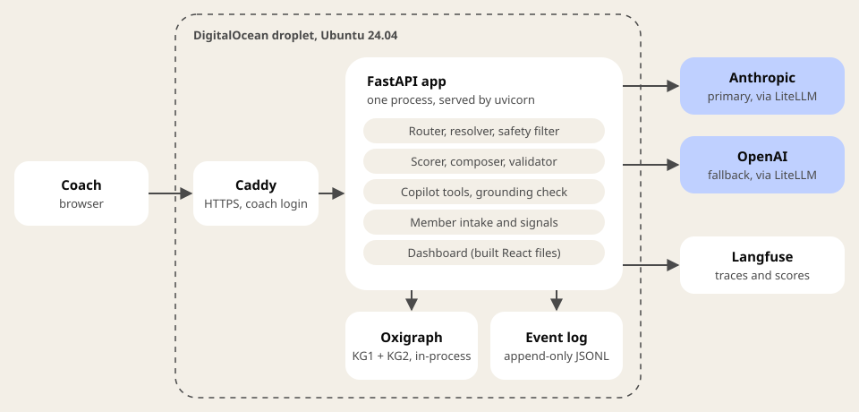
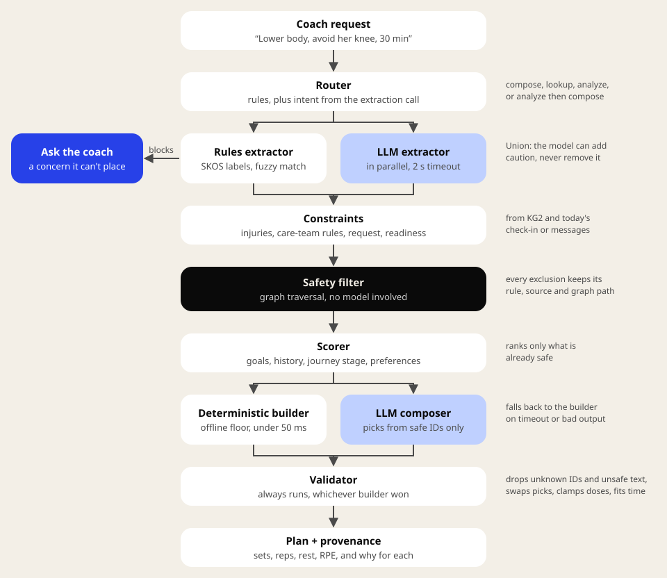
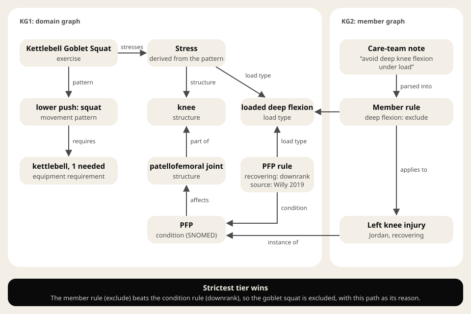
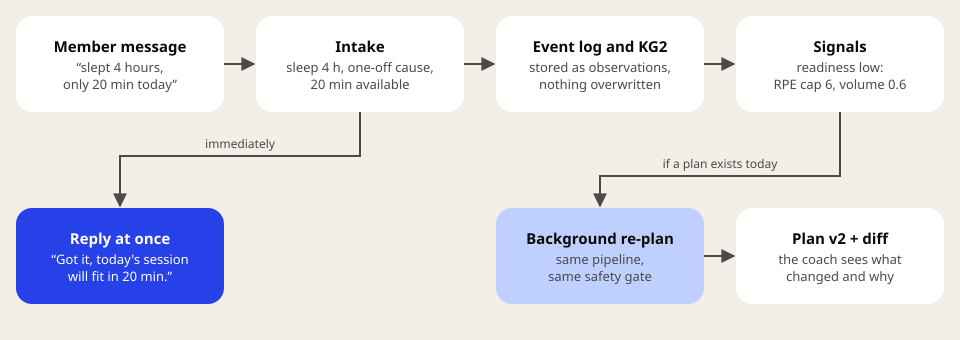
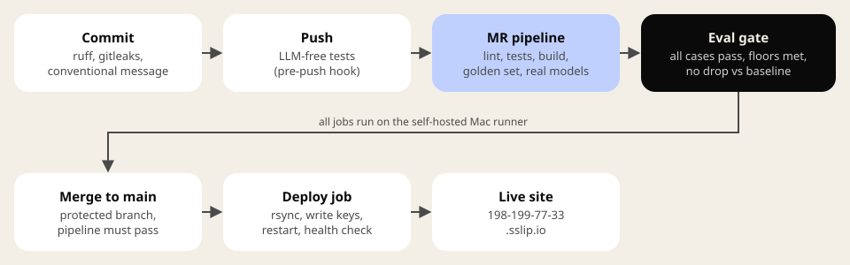

# Safe workouts, decided by the graph

Future Coach is a dashboard where a coach asks for a workout in plain words and gets a plan built for one member, with every exercise choice traced back to a rule. Language models help read the request and write the plan. A knowledge graph decides what is safe.

## The core rule

Safety is never a prompt instruction. Every exercise a coach sees has passed a deterministic graph traversal, whichever path produced it. A model can propose an exercise, but only the graph can allow it.

That one rule shapes the rest of the design:

- **The model picks only from a safe list.** The composer receives the IDs of exercises that already passed the safety filter, as an enum. It can't name anything else.
- **A validator checks every plan, every time.** Unknown IDs are dropped, unsafe picks are swapped for a safe substitute, and RPE is capped to the member's readiness.
- **When the system can't place a concern, it asks.** "Something's off with her hammy" blocks the plan until the coach names the body area.
- **Without a model, nothing gets less safe.** Offline, a rules extractor and a deterministic builder run the same pipeline through the same gate.

## How to read the diagrams

- **Plain boxes:** deterministic code.
- **Blue-tinted boxes:** steps that call a language model, each with a deterministic fallback.
- **The inverted box:** the step everything else depends on, where a diagram has one.
- **The solid blue box:** what the coach or member sees first when the system stops or replies.
- **Dashed outline:** a host machine, not a component.

## System and deployment

Everything runs in one Python process on a single droplet. Caddy terminates HTTPS and puts one coach login in front of the whole app. FastAPI serves the API and the built React dashboard from the same port, so there's one thing to run and one thing to deploy.

- **Graph store:** Oxigraph runs embedded (pyoxigraph), not as a server. It holds two named graphs: KG1 (the domain) and KG2 (members).
- **Runtime writes:** check-ins, messages and plan versions are appended to an event log and replayed into KG2 at startup. Nothing is updated in place, so every input stays auditable. A third named graph holds each plan's PROV-O record, rebuilt from the same log.
- **Models:** LiteLLM runs as a library inside the app. Each tier has a primary Anthropic model and an OpenAI fallback.
- **Tracing:** every request writes a trace to Langfuse when keys are set, or to structured JSON logs otherwise.

## The workout pipeline

After the request arrives, it moves through eight steps. Only two model calls happen along the way: the extraction call, which also feeds the router, and the composer. Each has a deterministic stand-in.

1. **Router.** Keyword rules settle the obvious cases. Otherwise the extraction call (which runs anyway) also returns an intent, so routing adds no extra model call. A rules-versus-model conflict routes to the broadest path.
2. **Resolver.** Two extractors run in parallel: rules over the graph's SKOS labels (exact, then fuzzy, then a local embedding model for body-part slang), and a small model with a 2 second timeout. Their results are merged so that the model can only add caution. If the model finds a constraint the rules missed, it counts. If the rules find one the model missed, it still counts.
3. **Constraints.** The member's injuries and care-team rules come from KG2. The coach's request adds exclusions, equipment and time. Today's readiness sets an RPE cap.
4. **Safety filter.** A graph traversal over every exercise. Each exclusion keeps its rule, its source and the graph path that triggered it.
5. **Scorer.** Ranks the safe set by the request's targets, the member's goals, recent history (for variety), journey stage and dislikes.
6. **Composer.** The model picks and doses exercises from the top of the safe list. On timeout or bad output, the deterministic builder produces the plan instead, in under 50 ms.
7. **Validator.** Always runs. Model text never replaces the graph's safety cue for an exercise, and any cue, reason or summary that coaches through pain or gives clinical advice is dropped. Reps, holds and rest are clamped to sane ranges, and every repair is logged without echoing the model's text. More than two repairs and the model's plan is rejected outright, so after a second failed try the deterministic builder answers. It also fits the plan to the time window, trimming accessories first and filling short plans, but it never adds volume to an exercise that carries an injury modification.
8. **Plan and provenance.** The coach sees each exercise with sets, reps, rest, RPE, a pictogram and why it was picked, plus everything excluded and why, drawn as the graph paths that decided it. The same record is written to the store as W3C PROV-O.

Fail-closed rules live in the resolver: a safety word ("pain", "sore", "tweaked") in a sentence with no resolved body area blocks the plan, and so does a body area the model flags that the graph can't resolve. The embedding pass never resolves a safety concern; it can only add a suggestion to the question ("Did you mean the hamstrings?"). Goals fail open: an unknown target just drops out, with a note.

## The knowledge graph

The diagram follows one real exclusion from the required knee scenario.

- **Exercises don't just "load the knee".** Each exercise has n-ary *stress* nodes: which structure, which load type, and where that came from (usually its movement pattern). Knee load types separate impact, loaded deep flexion, loaded shallow flexion, open-chain work and kneeling contact. That's what lets the graph allow a box squat for a sore knee while excluding jump lunges, and allow kneeling exercises at all.
- **Anatomy is a part-of hierarchy, walked in both directions.** A rule about the patellofemoral joint reaches exercises that stress the knee, and a rule about the knee reaches its parts.
- **Conditions carry rules as data.** Each rule names a condition, a load type, a stage (acute, recovering, cleared) and a tier (exclude, downrank, allow, uprank). It also carries a cue, a source, a confidence level and a review status. All of them ship as `unreviewed` until a clinician signs off.
- **A member's injury is an instance of a condition,** with its side and stage. Care-team notes are parsed into member rules by matching the graph's load-type labels ("avoid deep knee flexion under load" becomes an exclude rule).
- **The strictest applicable tier wins.** In this example the condition's own rule only downranks deep flexion for a recovering knee, but Jordan's care team said to avoid it, so the goblet squat is excluded.
- **Exercise families and equipment are graph edges too.** "No deadlift variations" follows `variant-of` to the deadlift family, so RDLs go while kettlebell swings stay. Equipment is checked with quantity: a double-kettlebell exercise fails when the member has one kettlebell.

Equipment, movement patterns and conditions align to EXMO where it has a matching class: 47 SKOS mappings, each checked against the current EXMO release. Anatomy and conditions carry SNOMED CT codes only, never licensed descriptions. COPPER was evaluated and not mapped, because its own IRIs don't resolve and its license is non-commercial. Everything else (load types, rules, the stresses relation) is our own schema.

## Member data and re-planning

Members can check in on the day or message hours before a session. Both feed the same pipeline.

- **Intake parses the message** into observations: sleep hours, pain by area and score, time available, equipment today, and context such as a one-off cause ("baby up all night").
- **Signals are computed deterministically,** one job per timescale. Readiness compares today against the member's own baseline and sets an RPE cap of 8, 7 or 6 with a matching volume factor. Journey stage (onboarding, building, established, at-risk, rehab) shapes selection and progression. Churn risk counts completed weeks only, so a two-day-old week can't look like a collapse.
- **New data can only make a plan more cautious.** A check-in can lower intensity or add a constraint. It never loosens a safety rule.
- **The reply comes first.** The member gets an acknowledgement at once. If today's plan exists, it is rebuilt in the background through the same pipeline, saved as a new version, and shown to the coach as a diff.

## The copilot

The copilot answers questions about a member ("Is she a churn risk?", "Congratulate her on yesterday's workout"). It works like a small research loop with hard limits.

- **Tools return evidence with IDs.** Sleep, adherence, messages, labs, churn and yesterday's session each come back as data plus citable evidence.
- **Every paragraph must cite evidence.** A grounding check rejects uncited claims, quotes that don't appear word for word in a source, and anything that reads as clinical advice (supplements, doses, medications) or tells a member to push through pain. Plans and answers share the same wording guard.
- **One repair round, then a safe fallback.** A rejected answer goes back to the model once with the reasons. If it fails again, a deterministic writer answers from the same evidence.
- **Workout requests go through the same gate.** "Build her a 30 minute lower body workout" asked in the copilot runs the full pipeline above.

## Models and latency

| Tier | Primary | Fallback | Used for |
|---|---|---|---|
| Small | Claude Haiku 5.5 | GPT-5 mini | extraction, routing, composing plans |
| Mid | Claude Sonnet 5.5 | GPT-5.4 | copilot answers |
| Large | Claude Opus 5.5 | GPT-5.4 | available, unused by default |

| Path | Typical time |
|---|---|
| Offline plan, or a blocked request | under 50 ms (about 2 s with the model extractor) |
| Plan with the model composer | draft in about 2 s, final in 8 to 20 s |
| Copilot answer | 4 to 15 s |

The model composer alone misses the original 5 second target, so the dashboard streams the plan: as soon as the safe candidates are scored, the coach gets a draft from the deterministic builder, already through the validator (typically within 2 s), and the composer's version replaces it when it arrives. Only the final plan is stored. Member messages already avoid the wait: the reply comes first and the re-plan runs in the background.

## Observability and evals

Every request gets one trace: route and confidence, each extractor's mentions, constraints, every exclusion with its reason, and per-step model, tokens, cost and latency. Coach thumbs up or down attaches to the trace as a score. Member and coach free text is never logged.

The golden set has 23 cases: the three required scenarios across members, three prompt-injection attempts (a member message, a coach request and a copilot question each telling the system to drop its rules), the traps from the spec review ("back squat" is not a back injury, "my pecs" is a target, an unplaceable hamstring must block), readiness and message cases, and copilot grounding cases. The eval runner re-derives safety from the graph on its own and doesn't trust the pipeline's claims.

| Metric | Floor |
|---|---|
| Schema valid, safety respected, citation present, grounded, fail closed, plan fill, no member text in logs | 100% |
| Model path used (no silent fallback) | 80% |

A merge also fails if any metric drops more than 5% (relative) below the committed baseline. The model-path metric is held by its floor only, because one flaky reply moves it about 6 points.

## Delivery

Local hooks catch formatting, secrets and commit-message problems before anything leaves the laptop. Every merge request runs lint, the LLM-free test suite, the dashboard build and the golden set against real models. `main` is protected, so code reaches it only through a merge request with a green pipeline, and every merge deploys itself: the job copies the build to the droplet as a limited `deploy` user, writes the API keys from GitLab's masked variables, restarts the service and checks its health endpoint.

## Where the code lives

| Area | Path |
|---|---|
| Graph build and SPARQL helpers | `backend/app/graph/` |
| Domain graph source (anatomy, patterns, conditions, equipment) | `backend/kg/*.ttl` |
| Safety filter | `backend/app/safety/filter.py` |
| Resolver and router | `backend/app/resolver/` |
| Member graph, intake, signals | `backend/app/member/` |
| Scoring, composing, validating | `backend/app/plan/` |
| Copilot tools and grounding | `backend/app/copilot/` |
| Model access and tracing | `backend/app/llm.py`, `backend/app/observability.py` |
| Golden set and gate | `backend/evals/` |
| Dashboard | `frontend/src/` |
| Server setup | `scripts/bootstrap.sh` |

Each design decision, with the options considered and why one won, is in [`docs/DECISIONS.md`](../DECISIONS.md). Worked examples with full filtering traces are in [`docs/examples.md`](../examples.md).
